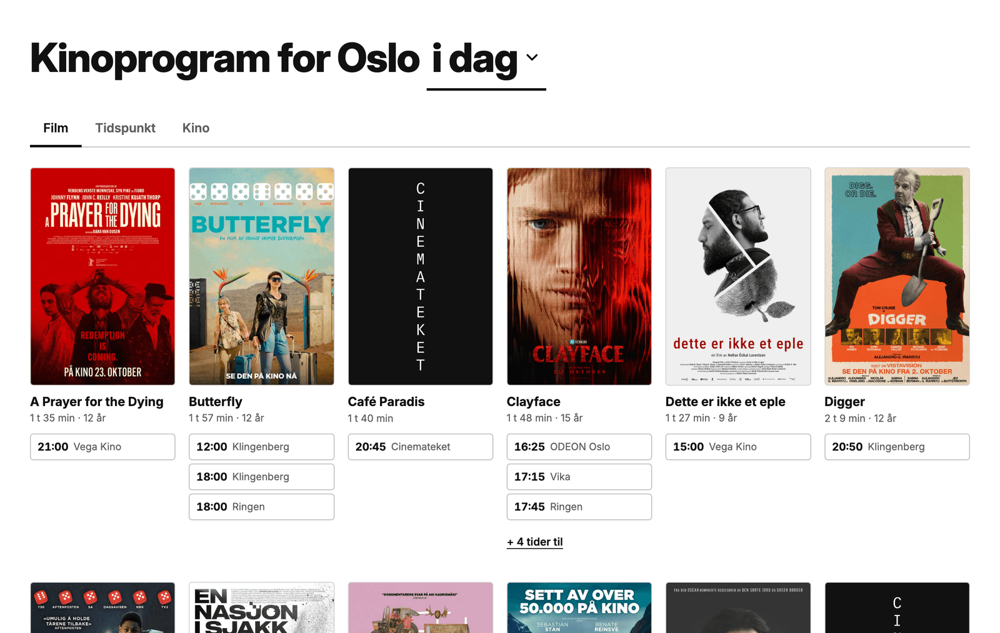

# Kinoprogram for Oslo

**→ [kinoprogram.vercel.app](https://kinoprogram.vercel.app)**

Every cinema in Oslo and what's showing, on one page.

## Development

A static Astro site that is rebuilt several times a day with the latest program. The data is fetched when the site is built, not when a page loads, to limit traffic to the data sources.

## Data

The website is built from publicly available data:

- **Filmweb** (`movieinfoqs.filmweb.no/graphql`): showings with times and ticket links, and for each film the poster, synopsis, length, age rating and production year.
- **Cinemateket** (`cinemateket.no/cinemateket-webcal.ics`): showings with times, screen, description and a link to the event.
- **TMDB** (`api.themoviedb.org`): user scores, trailers, directors and cast for the film pages, and posters for films whose source has none, such as Cinemateket's.
